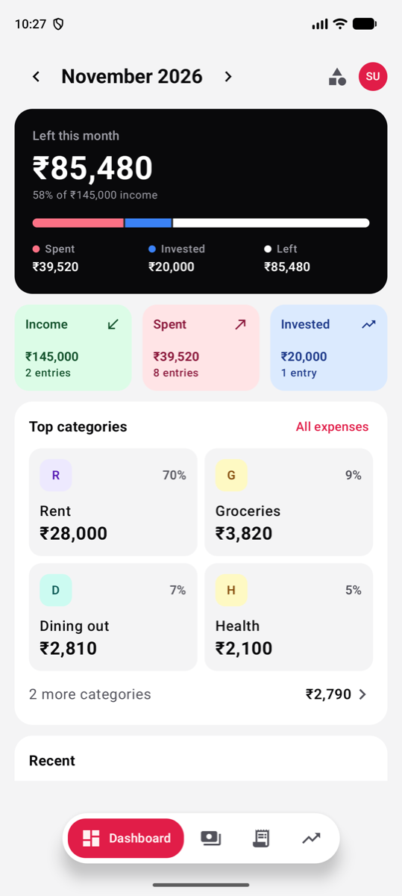
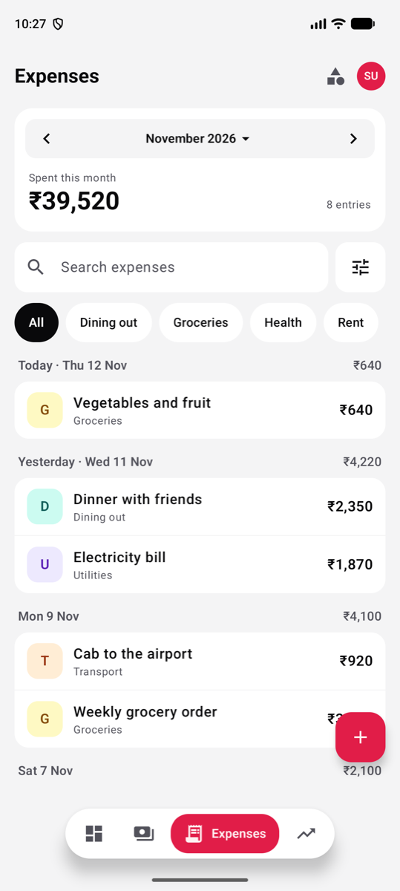
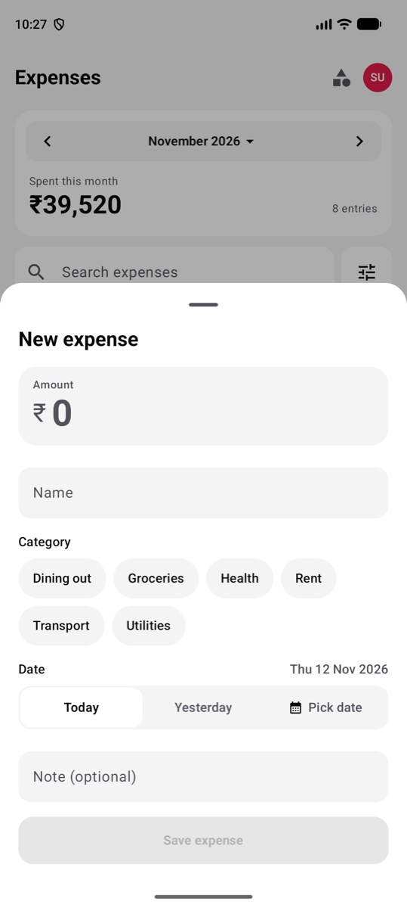
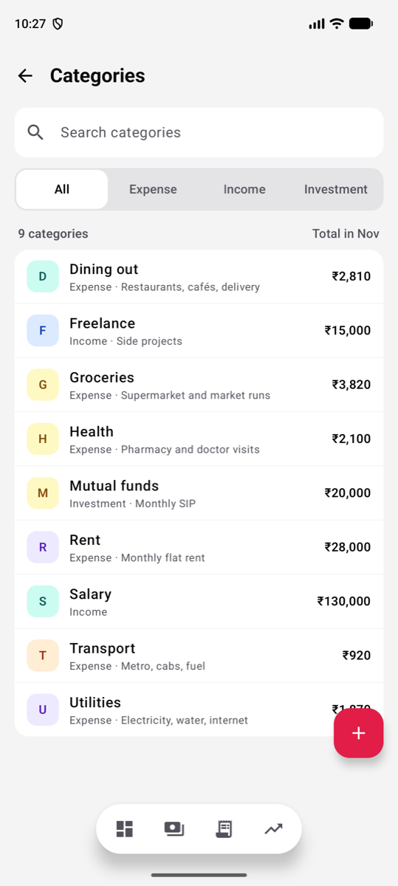
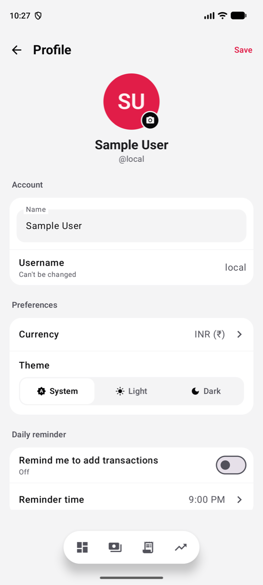
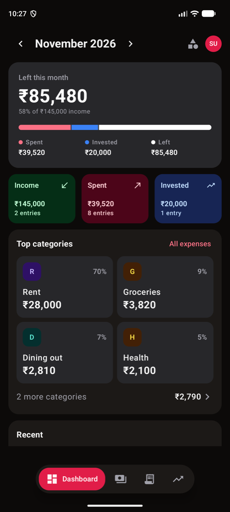
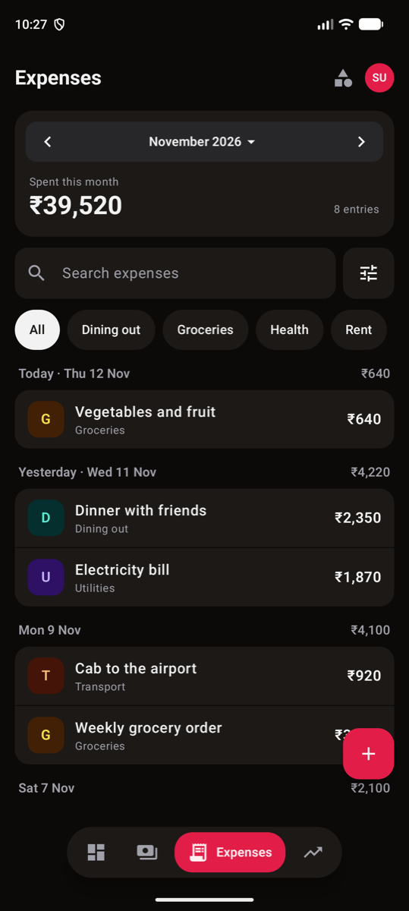
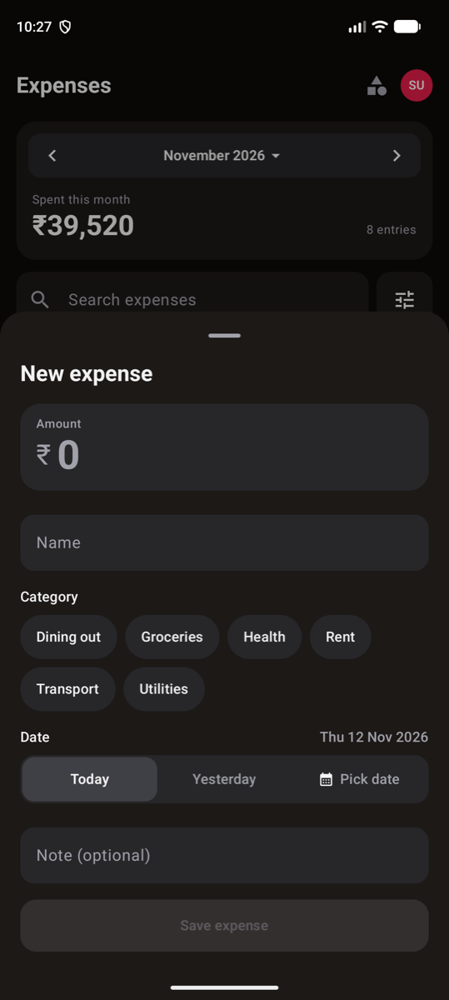
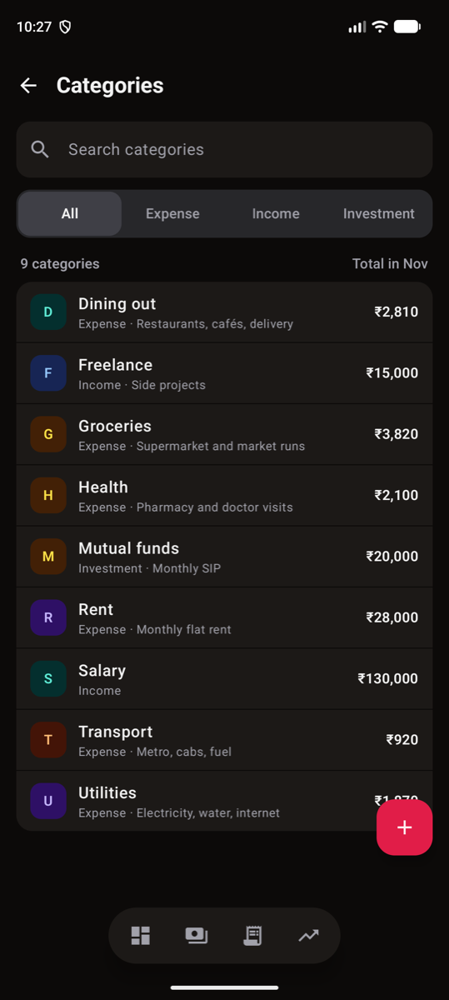
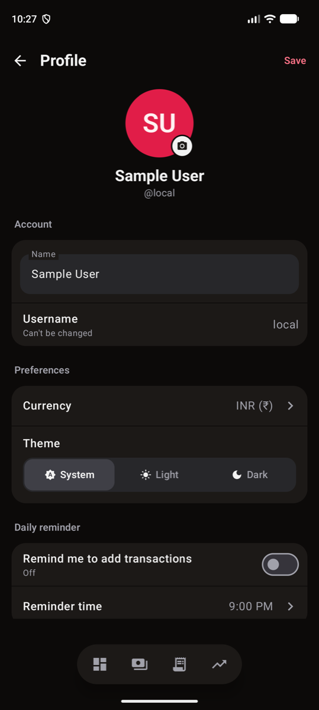

# Expenser

An offline-first Android app for tracking expenses, income and investments.
Built with Kotlin, Jetpack Compose and Room. Everything stays on the device:
there is no server, no account and no network access.

Ported from the `expenser` web app (React UI + Go/Postgres server), which stays
a separate project.

## Screenshots

| Dashboard | Expenses | New expense | Categories | Profile |
| :---: | :---: | :---: | :---: | :---: |
|  |  |  |  |  |
|  |  |  |  |  |

Screenshots use sample data.

## Features

- **Dashboard** for the selected month:
  - what's left of income after spending and investing, with a bar splitting income into spent / invested / left;
  - Income, Spent and Invested tiles, each opening its own list;
  - top spending categories;
  - the most recent entries.
- **Expenses, Income and Investments** lists:
  - grouped by day, with a subtotal for each day;
  - search, one-tap category filters, and date-range and sort options;
  - swipe to delete, with undo.
- **Quick entry sheet**: the amount comes first, categories are pills, and Today / Yesterday / Pick date set the date.
- **Categories** of three types (expense, income, investment), with this month's total for each. A category that is in use can't be deleted.
- **Month scope** shared by every screen. Step month by month, or pick "All time".
- **Profile**:
  - name and photo;
  - currency (INR, USD, EUR, GBP, JPY, AUD, CAD, SGD, AED);
  - light, dark or system theme, previewed live;
  - an optional daily reminder notification.
- **Your data**: export a full backup to a file and import it again, or export transactions as CSV.

## Design

The UI uses a "bento" layout: borderless rounded cards on a soft grey ground in
light mode, lifted dark cards on a near-black ground in dark mode, and a single
rose accent. A few rules hold across screens:

- **One dark hero card** on the dashboard is the only inverted element, so the
  month's headline number reads first.
- **Category badges** are a letter on a tint picked from a fixed palette by the
  category's id. Colours stay stable across renames, and no colour is stored.
- **Amounts in single-type lists are neutral.** Colour and a +/− sign appear only
  where types mix, in the dashboard's Recent list.
- **Contrast meets WCAG AA** in both themes. Rose text in dark mode uses a lighter
  shade, because the brand rose is too dark to read as text there.
- **Touch targets are at least 44dp.**

Shared building blocks (cards, badges, chips, the segmented control) live in
[`ui/common/Bento.kt`](app/src/main/java/com/expenser/app/ui/common/Bento.kt),
and colours in [`ui/theme`](app/src/main/java/com/expenser/app/ui/theme).

## Tech stack

| | |
| --- | --- |
| Language | Kotlin 2.4 |
| UI | Jetpack Compose (Material 3), Navigation Compose |
| Storage | Room (SQLite), money as `Long` minor units, ISO `yyyy-MM-dd` dates |
| DI | Manual: an `AppContainer` on the `Application`, no Hilt |
| Build | Gradle 9.7 (wrapper included), Android Gradle Plugin 9.3 |
| Android | minSdk 26 (Android 8.0), targetSdk 36, compileSdk 37 |

## Project structure

```
app/src/main/java/com/expenser/app/
├── data/
│   ├── backup/     JSON backup codec, CSV export, file I/O
│   ├── db/         Room database, DAOs, entities, converters
│   ├── model/      EntryType, ThemeMode
│   ├── reminder/   daily reminder alarm and notification
│   └── repo/       repositories over the DAOs
├── di/             AppContainer (manual dependency wiring)
└── ui/
    ├── common/     shared list screen, entry sheet, bento components, money formatting
    ├── dashboard/  dashboard screen and its pure summary logic
    ├── expense/ income/ investment/   thin wrappers over the shared list screen
    ├── category/   categories screen and sheet
    ├── profile/    profile, reminder and backup sections
    ├── nav/        bottom navigation and routes
    └── theme/      colours, shapes, typography
```

Expense, Income and Investment are one `transactions` table with a type column,
so the three list screens share a single screen and view model, parameterised by
`EntryType`.

## Build and run

You need JDK 21 or newer (CI uses 25) and the Android SDK. Open the project in
Android Studio and press **Run**, or use the wrapper:

```bash
./gradlew installDebug          # build and install on a connected device or emulator
```

```bash
./gradlew testDebugUnitTest     # unit tests
```

```bash
./gradlew assembleDebug         # debug APK in app/build/outputs/apk/debug/
```

## Tests

Unit tests cover the logic that doesn't need a device:

- money parsing and formatting;
- list filtering and sorting;
- day grouping and day labels;
- the dashboard's month summary and category ranking;
- the category filter and category rules;
- the backup codec and CSV export;
- reminder scheduling.

They live in `app/src/test`.

## Continuous integration and releases

- **Pull requests** to `main` build a debug APK and run the unit tests
  ([`pr-check.yml`](.github/workflows/pr-check.yml)).
- **Publishing a GitHub release** tagged like `v1.2.3` builds a signed release APK
  and attaches it to the release ([`build-apk.yml`](.github/workflows/build-apk.yml)).
  The version name and code come from the tag. Signing uses the repository secrets
  `KEYSTORE_BASE64`, `KEYSTORE_PASSWORD`, `KEY_ALIAS` and `KEY_PASSWORD`.

## Further reading

- [CONTEXT.md](CONTEXT.md): domain glossary (category, type, transaction, amount).
- [docs/adr](docs/adr): architecture decisions:
  - [0001](docs/adr/0001-native-android-rewrite.md) native Android rewrite instead of reusing the React frontend;
  - [0002](docs/adr/0002-single-transactions-table.md) single transactions table with a type discriminator;
  - [0003](docs/adr/0003-uuid-string-primary-keys.md) UUID string primary keys.
